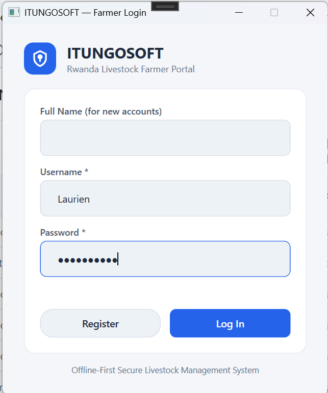
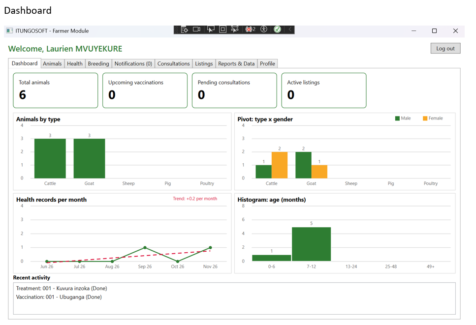
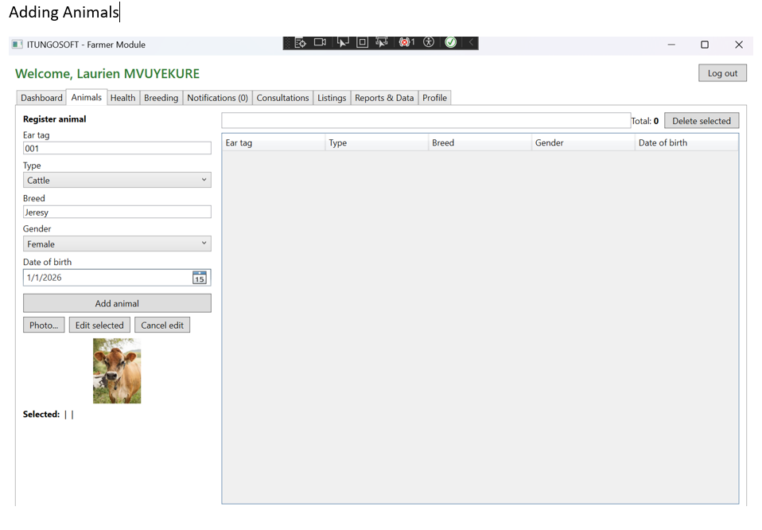
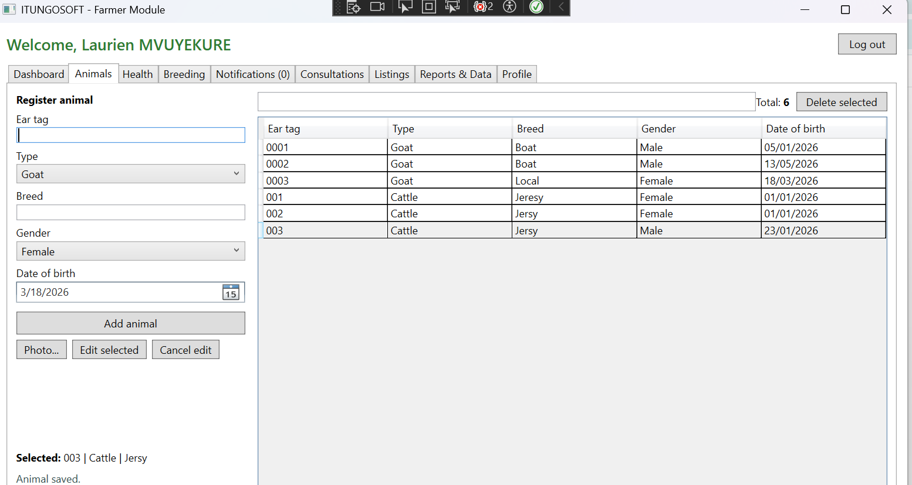
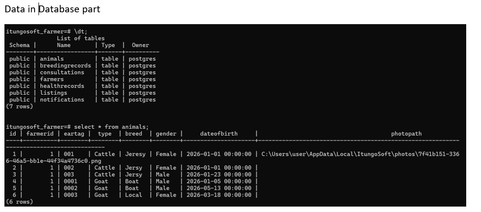
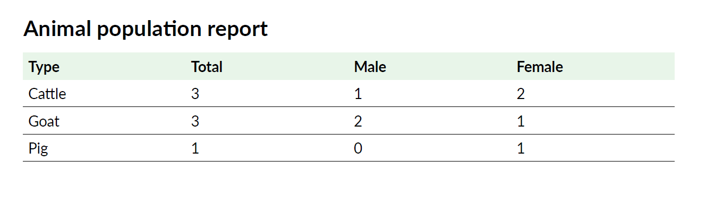

# ITUNGOSOFT Desktop App - Farmer Module

A .NET desktop application that helps individual livestock farmers in Rwanda replace paper record-keeping with a digital, offline-first system. It covers animal registration, health and vaccination tracking, breeding management, veterinary consultation requests, livestock listings, reminders, reports and data backup.

**STUDENT:** Laurien MVUYEKURE (28319) - Software Engineering, Adventist University of Central Africa (AUCA)

**Course:** .NET 

---

## 1. Background

According to the Fifth Rwanda Population and Housing Census (2022, NISR), many households keep cattle (27.9%), goats (19.4%), pigs (14.9%) and poultry (12%). Many farmers still rely on paper records, which leads to lost data, missed vaccinations and poor breeding management. This module gives a farmer one place to keep all of that on a desktop computer, without needing a permanent internet connection.

## 2. Technology

| Area | Choice |
|---|---|
| Language / runtime | C# on .NET 8 |
| User interface | WPF (Windows Presentation Foundation) |
| Architecture | MVVM, using CommunityToolkit.Mvvm 8.3.2 |
| Database | PostgreSQL (local), database name `itungosoft_farmer` |
| Data access | Entity Framework Core with Npgsql provider 8.0.11 |
| PDF reports | QuestPDF 2024.12.3 (Community license) |
| Charts | Drawn with built-in WPF shapes (no chart library) |
| Password storage | PBKDF2-SHA256, 100,000 iterations, random salt per user |

## 3. Features

| Module | What it does |
|---|---|
| **User management** | Register, log in and out, edit profile, change password. One farmer account per installation. |
| **Animals** | Register, edit, delete, search and view details. Types: cattle, goat, sheep, pig, poultry. Photo upload. Ear tags are unique per farmer. |
| **Health** | Record vaccinations, treatments, deworming and checkups, or schedule them. Status shows Done, Upcoming or Overdue. Health history per animal. |
| **Breeding** | Record matings (female, male ear tag, method, date). Expected delivery date is calculated from the species. Pregnancy status and birth outcome. Breeding history. |
| **Consultations** | Create veterinary consultation requests and record the response. |
| **Listings** | List animals for local sale with a price. Activate, deactivate or delete a listing. |
| **Notifications** | In-app reminders for health tasks due within 7 days or overdue, deliveries due within 14 days, and consultation responses. Unread count shown in the tab title. |
| **Dashboard** | Total animals, upcoming vaccinations, pending consultations, active listings, recent activity, and four charts (bar, pivot, linear trend, histogram). |
| **Reports and data** | PDF reports (animal population, health summary, breeding performance), CSV export, database backup and restore. |

Gestation and incubation periods used for expected delivery: cattle 283 days, goat 150, sheep 147, pig 114, poultry 21.

## 4. Screenshots

### 4.1 Login and registration
A new farmer registers with a full name, username and password (minimum 6 characters). After that, the same screen is used to log in.



### 4.2 Dashboard
Key metrics at the top, then four charts: animals by type (bar chart), animals by type and gender (pivot chart), health records per month with a dashed linear trend line, and an age histogram in months. Recent activity is listed at the bottom.



### 4.3 Registering an animal
The form on the left takes ear tag, type, breed, gender and date of birth. "Photo..." attaches a picture, which is previewed under the form. "Edit selected" loads a row back into the form for changes.



### 4.4 Animal list
Registered animals can published on Market where someone can know that's Livestock is Forsale. Until now farmer as owner of livestock is only one to see that list of forsale livestock but for future (Web app) it will be visible for everyone access to platform



### 4.5 Data in PostgreSQL
The application creates seven tables in the `itungosoft_farmer` database. The query below shows the saved animals, including the stored photo path.



### 4.6 PDF report
The "Reports & Data" tab exports a PDF. This example is the animal population report, grouped by type with male and female counts.



## 5. Database tables

`farmers`, `animals`, `healthrecords`, `breedingrecords`, `consultations`, `listings`, `notifications`. All table and column names are lowercase, so queries need no quotation marks, for example `SELECT * FROM animals;`.

## 6. Getting started

### Requirements
- Windows 10 or 11
- Visual Studio 2022 or later with the **.NET desktop development** workload
- PostgreSQL (13 or newer recommended), running as a service on `localhost:5432`
- Internet access the first time, so NuGet can restore the packages

### Setup
1. Open `ItungoSoft.Farmer.csproj` in Visual Studio.
2. Open `Data/AppDbContext.cs` and set your PostgreSQL password in the connection string:
   ```csharp
   "Host=localhost;Port=5432;Database=itungosoft_farmer;Username=postgres;Password=YOUR_PASSWORD"
   ```
3. Restore NuGet packages (right-click the solution > **Restore NuGet Packages**).
4. Press **F5**. On first run the application creates the `itungosoft_farmer` database and all tables.
5. Click **Register** to create the farmer account, then log in.

### If you change the data model
The application uses `EnsureCreated()`, which only builds tables in an empty database. After changing an entity, drop the database and let the application recreate it. This deletes the data.
```
\c postgres
DROP DATABASE itungosoft_farmer WITH (FORCE);
```

### Backup and restore
The "Reports & Data" tab uses PostgreSQL's `pg_dump` and `pg_restore`. The application looks for them under `C:\Program Files\PostgreSQL\<version>\bin`. Restart the application after a restore.

## 7. Project structure

```
ItungoSoft.Farmer/
  App.xaml / App.xaml.cs        Startup, database creation
  Data/AppDbContext.cs          EF Core context and PostgreSQL connection
  Models/Entities.cs            Farmer, animal, health, breeding, notification, consultation, listing
  Services/
    AuthService.cs              Registration, login, profile, password change
    ExportService.cs            CSV, PDF reports, backup and restore
    ChartService.cs             Data for the dashboard charts
  ViewModels/
    AnimalsViewModel.cs         Animals tab
    FarmViewModel.cs            Health, breeding, notifications, dashboard
    ExtrasViewModel.cs          Consultations, listings, profile, reports
  Views/
    LoginWindow.xaml(.cs)       Login and registration
    MainWindow.xaml(.cs)        Tabbed main window
    ChartDrawer.cs              Bar, pivot, trend and histogram drawing
```

## 8. Known limitations

- Windows only (WPF). A cross-platform version could be built with Avalonia UI.
- Reminders are generated when the user opens or switches tabs, not by a background timer.
- Animal search is a single text box; there are no separate filter drop-downs.
- Birth outcome is free text; newborn animals are not registered automatically.
- Only one photo per animal.
- The database password is stored in source code, which is acceptable for coursework but should move to a settings file for real use.
- No SMS or email notifications, cloud synchronisation, payments, GPS tracking or multi-language support (English only).

## 9. Source of statistics

National Institute of Statistics of Rwanda (NISR), Fifth Rwanda Population and Housing Census, 2022.

